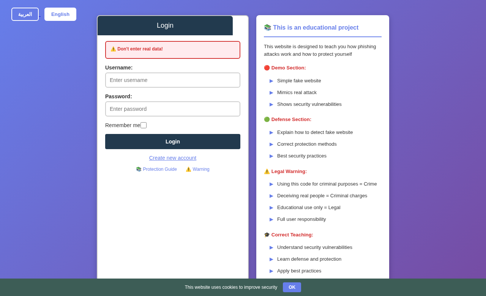
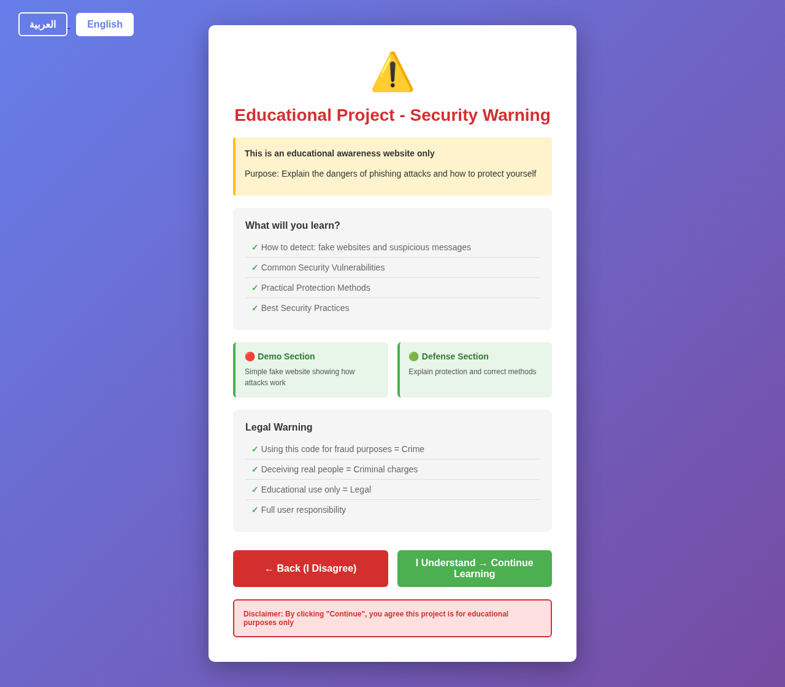
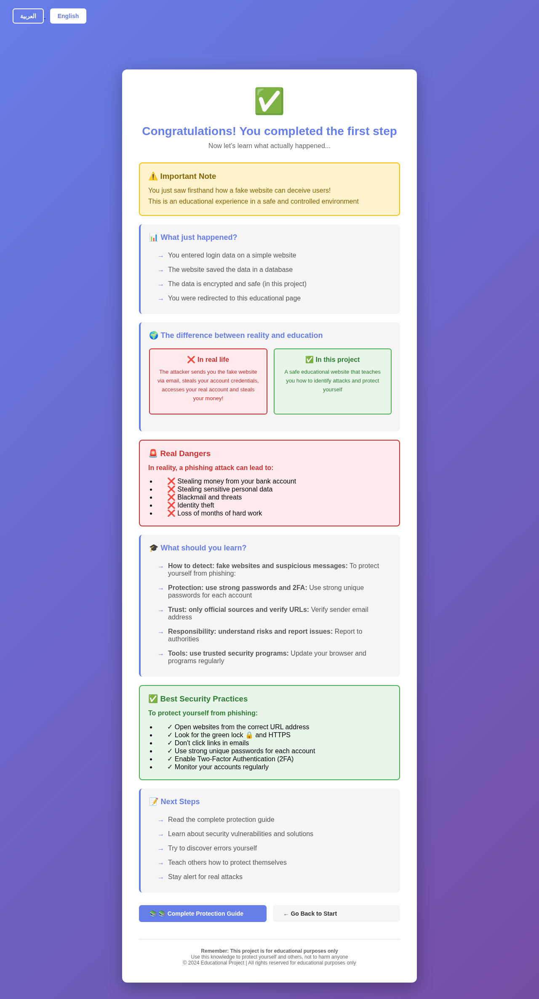
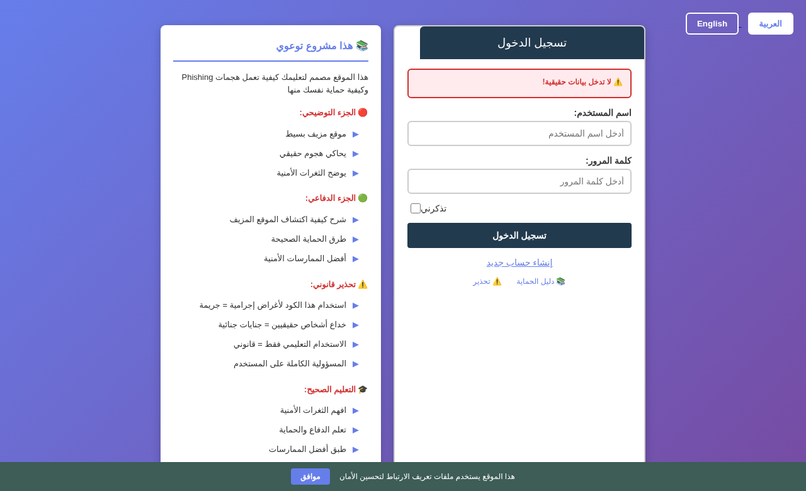
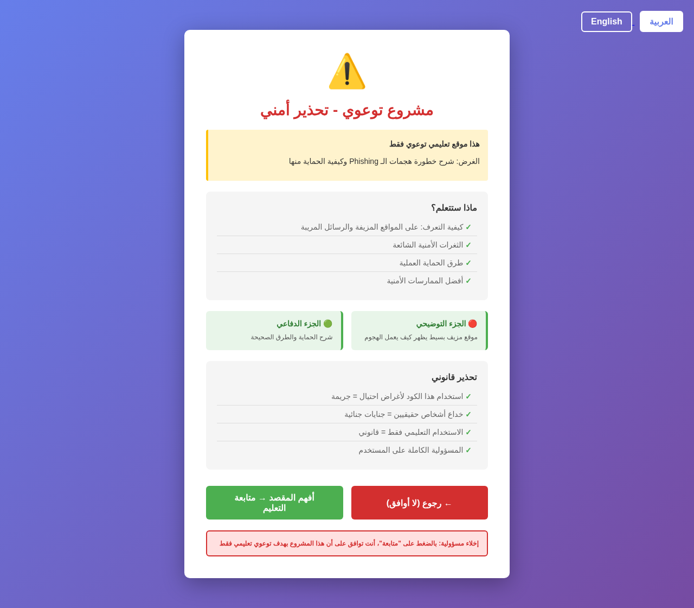
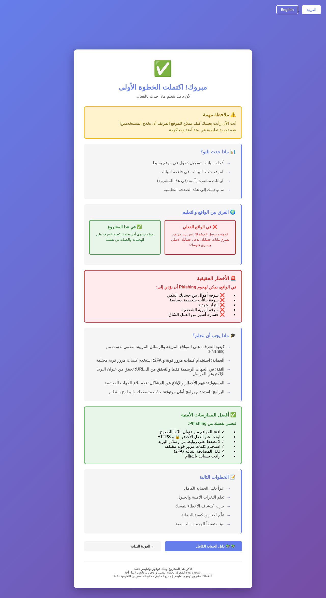

# PhishGuard

A graduation project in Information Technology: a controlled phishing simulation for security awareness education, built with PHP and MySQL.

PhishGuard shows how a phishing attempt works and how to defend against it, inside a safe, consent-based, local environment. It is a teaching tool and a reference for secure PHP code.

> **Educational use only.** Run it locally, with participants who know what the exercise is. Never use it against people who have not agreed. All data stays on the machine that runs it.

## What it does

1. **Consent page** (`warning.php`): explains that this is an educational simulation and what happens to the data. The participant must accept before seeing anything else.
2. **Simulated login page** (`index.php`): a realistic login form, used to show what a phishing page looks like.
3. **Debrief page** (`thank_you.php`): tells the participant right after submission what happened, what data was handled and which warning signs were present.
4. **Protection guide** (`protection_guide.php`): how to spot phishing, vulnerable vs secure code patterns, a self-check list and how to report phishing.

## Security features in the code

| Feature | Protects against |
|---|---|
| Prepared statements (PDO) | SQL injection |
| BCRYPT password hashing | Stored credential exposure |
| CSRF tokens | Cross-site request forgery |
| Input validation and output sanitization | Malicious input, XSS |
| Secure HTTP headers | Clickjacking, MIME sniffing |
| Rate limiting | Brute-force attempts |
| Audit logging | Traceability |

There are two versions of the login handler: `login_secure.php` (all controls in one file) and `login_secure_clean.php` (the same logic split into `Database`, `Validator`, `Security` and `Logger` classes), so you can compare both styles.

## Tech stack

- PHP (7.4 or newer, 8.x recommended)
- MySQL 5.7+ or MariaDB 10.3+
- Apache (for example through XAMPP) or PHP's built-in server
- HTML, CSS and JavaScript for the pages
- Language strings in `languages.php`

## Project structure

```
Educational Phishing/
  Backend/          login_secure.php, login_secure_clean.php
  Configuration/    config.php and Includes/ (Database, Logger, Security, Validator, languages)
  Database/         phishing_educational.sql
  Documentation/    README.md (full academic write-up), SETUP.md
  Frontend/         index.php, warning.php, thank_you.php, protection_guide.php
```

## How to run (local)

1. Install XAMPP (or any PHP + MySQL stack) and start Apache and MySQL.
2. Copy the `Educational Phishing` folder into `C:\xampp\htdocs\` (Windows) or `/var/www/html/` (Linux).
3. Create a database called `phishing` (utf8mb4) and import `Database/phishing_educational.sql` with phpMyAdmin or the `mysql` command.
4. Open `Configuration/config.php` and set your database host, name, user and password.
5. Make sure the `logs/` and `temp/` folders exist and are writable.
6. Open `http://localhost/Educational%20Phishing/Frontend/warning.php` in your browser.

Use only test data. The demo account is `demo_user` / `test123`.

Full details are in `Documentation/SETUP.md`.

## Screenshots

English interface:





Arabic interface:





## Ideas for future work

Two-factor authentication (TOTP), a simulated OAuth flow, automated tests (PHPUnit) and security scanning (OWASP ZAP).

## About the author

Built by Nasra Abdalhafiz, a PHP developer with a Bachelor of Information Technology (2024) and a focus on web security. GitHub: [@hexanr](https://github.com/hexanr)
